# R2C: Remote-to-Caller

**A white paper on letting a called agent or tool server talk back to its caller, over A2A and MCP**

**Status:** draft, 2026-11-20. Describes the approved v1 design (the
[design brief](research/2026-11-20-r2c-v1-design-brief.md) with its two amendments, and the ADRs
in [`design-docs/`](design-docs/)). Nothing here is normative: once `standard/v1/README.md` is
written, it wins over this paper.

> **Note 2026-11-20:** the normative text is now written in
> [`standard/v1/README.md`](../standard/v1/README.md) and wins over this paper. The wire excerpts
> in §6.3 and §7 are taken from its examples. Deviations from the design brief (D1–D4) are listed
> in [`specs/001-standard-v1/research.md`](../specs/001-standard-v1/research.md).
>
> **Note 2026-11-20 (spec 002):** `ext_r2c.core` now exists. §10.3 and §11 use its names
> ([`specs/002-python-core/contracts/core-api.md`](../specs/002-python-core/contracts/core-api.md)):
> a source declares `pause`, a checkpoint source is resumed with `resume(answer, ctx)`, one
> `Driver` runs both styles, and a lost live run ends with the error `lost`.

---

## Contents

1. [Summary](#1-summary)
2. [The problem](#2-the-problem)
3. [What R2C is, and what it is not](#3-what-r2c-is-and-what-it-is-not)
4. [Roles and vocabulary](#4-roles-and-vocabulary)
5. [The six kinds](#5-the-six-kinds)
6. [How it works on A2A](#6-how-it-works-on-a2a)
7. [How it works on MCP](#7-how-it-works-on-mcp)
8. [Identifiers, state and resume](#8-identifiers-state-and-resume)
9. [Trust and safety model](#9-trust-and-safety-model)
10. [The SDK: one adapter, `Remote`](#10-the-sdk-one-adapter-remote)
11. [Agent frameworks: the LangGraph bridge and the next ones](#11-agent-frameworks-the-langgraph-bridge-and-the-next-ones)
12. [Compatibility and graceful degradation](#12-compatibility-and-graceful-degradation)
13. [Use cases](#13-use-cases)
14. [Key design decisions](#14-key-design-decisions)
15. [Limits and non-goals](#15-limits-and-non-goals)
16. [Roadmap](#16-roadmap)
17. [Glossary](#17-glossary)
18. [References](#18-references)

---

## 1. Summary

Agents increasingly call other agents (over **A2A**) and tool servers (over **MCP**). The party
being called (the **remote**) often needs something back from the party that called it (the
**caller**) before it can finish: a missing piece of information, permission to do something
irreversible, a place to put the file it produced. Today each remote invents its own way to do
this, usually as free text, and the caller cannot tell a question from an approval, cannot draw
a form, and cannot show a file or a live screen properly.

**R2C** is a small, optional **extension** to A2A and MCP that standardises this traffic. It
defines six kinds of object, `question`, `approval`, `answer`, `artifact`, `activity` and
`usage`, and exactly where each one sits inside the messages the two protocols already exchange.
It adds no new transport and changes no core structure.

R2C ships as a **standard** (`standard/v1/`: normative text, JSON Schemas, wire examples) and a
**Python SDK** (`ext-r2c`) whose single adapter, `Remote`, wraps an existing agent, tools and
skills and exposes them over A2A, MCP or both. The remote's own logic does not change: one
install, one wrapping line.

## 2. The problem

### Who hurts today

**The caller's user.** A remote agent stops and says, in text, "Should I publish the release
notes to the public site?". The caller sees a string. It cannot tell that this is a request for
approval rather than a question. It cannot show a proper dialog, and its own model may answer
"yes" on the user's behalf without anyone seeing it. When the remote produces a spreadsheet or
runs a live build screen, the caller has no reliable way to tell a file to download from a page
to embed.

**The remote's owner.** To ask a person anything through a caller, the owner hand-writes the
glue between their agent framework and the protocol (about 60 lines of `AgentExecutor` in the
official A2A LangGraph sample) and invents a way to describe the question. Every remote does it
differently, so no caller can handle them all.

**Everyone, on progress.** A caller that renders its own agent's run as a streamed reply, a
timeline of tool calls with durations, and a token/cost meter can show a remote's run only as
lines of free text.

### Why the protocols do not solve it alone

| Need | A2A 1.0 core | MCP 2026-07-28 core |
|---|---|---|
| Stop and wait for input | yes: task state `input-required` | yes: `tools/call` returns `input_required` (multi-round-trip requests) |
| Describe *what* is asked (fields, options) | no schema field | elicitation, but only a flat schema |
| Tell an approval from a question | no | no |
| Say who must answer (person, approver, caller agent) | no | no (elicitation always goes to the user) |
| Decline | no "decline" in core | `decline` / `cancel` |
| Mark a file vs inline content vs a live page | artifacts exist, but not this distinction | content types exist, but not this distinction |
| Structured progress (tool start/finish, nesting) | free status text | free progress `message` |
| Usage (tokens, time, cost) | no | no |

R2C fills exactly these gaps, using each protocol's own extension points.

## 3. What R2C is, and what it is not

**R2C is:**

- An **extension**, identified by a name that is never fetched at runtime:
  - A2A URI: `https://github.com/timezlab/ext-r2c/tree/main/standard/v1`
  - MCP `_meta` key: `io.github.timezlab/r2c`
- **Optional** (`required: false`). A client that does not activate it, and a remote that does
  not implement it, keep working in plain text.
- A **standard first**. The JSON Schemas are the single source of shape, and the wire examples
  are the shared test suite every SDK must pass.
- **One SDK adapter** (`Remote`) that turns an existing LangChain/LangGraph agent, a
  hand-written A2A executor, plain Python tools and skill folders into an A2A agent, an MCP
  server, or both.

**R2C is not:**

- A new protocol or transport. Identity, auth and transport stay with A2A, MCP and the
  deployment.
- A gateway translating A2A into MCP or back. An agent task and a tool call differ in kind.
- A UI framework. Drawing the form is the caller's job; a live view is the remote's own page.
- A decision engine. When to ask is the remote's logic; who answers is the caller's routing.

## 4. Roles and vocabulary

| Role | Meaning |
|---|---|
| **remote** | The called party, the one that asks: an A2A agent or an MCP server |
| **caller** | The party that called the remote: a chat app, another agent, a workflow, a CLI, an IDE |
| **person** | The human the caller's session acts for |
| **approver** | A human with the right to approve, possibly not the person (four-eyes approval) |
| **policy** | A rule held by the caller and applied by code ("always allow this remote to read the inventory report") |

A **door** is one protocol endpoint a remote opens: A2A or MCP. A remote may open one or both.

## 5. The six kinds

| Kind | Direction | Purpose |
|---|---|---|
| `question` | remote → caller | A form: one or more fields the remote needs to continue |
| `approval` | remote → caller | A request to allow, edit or deny **one** action with effects outside the remote |
| `answer` | caller → remote | The reply to a `question` or an `approval` |
| `artifact` | remote → caller | Annotation on a standard artifact: a file, inline content (including the streamed reply), or a live page |
| `activity` | remote → caller | What the remote is doing: a tool call, a step, or reasoning (if the remote allows it) |
| `usage` | remote → caller | Tokens, time and cost the remote reports for the task |

Every implementation **must ignore** an unknown kind, an unknown `activity.type` and an unknown
field. New kinds (for example `provenance`, `caller_context`) can therefore arrive later without
breaking v1.

### 5.1 Common fields of `question` and `approval`

```jsonc
{
  "kind": "question" | "approval",
  "id": "q-7f3a",                  // required; never reused within a task
  "title": "Pick the target environment",     // required; one line
  "description": "Staging was refreshed this morning…",   // optional, markdown
  "answer_by": { "role": "person" | "caller" | "approver", "approver_role": "Release manager" },
  "expires_at": "2026-11-21T17:00:00Z",       // optional; past it: question → declined, approval → deny
  "origin": { "name": "…", "url": "…" },      // only when forwarded from another remote
  "errors": [{ "key": "env", "message": "…" }] // only on a re-ask after a bad answer
}
```

Rules: a task has at most **one** pending request; the remote checks expiry itself; an answer
with a wrong `id` or after expiry is refused in text; an answer that fails validation makes the
remote send **the same request again**, same `id`, with `errors`, and the remote's model never
sees the bad attempt.

### 5.2 `question`

A form of fields, each of type `one` (single choice), `many` (multiple choice), `text`,
`number` or `bool`, with options, an "other" free-text escape (on by default) and `required`
(on by default). The adapter **generates** the JSON Schema used to validate the answer from
the form; nobody writes one by hand.

```jsonc
{ "kind": "question", "id": "q-7f3a", "title": "Pick the target environment",
  "answer_by": { "role": "person" },
  "fields": [{ "key": "env", "header": "Environment", "text": "Where should the build go?",
               "type": "one",
               "options": [{ "label": "staging" },
                           { "label": "production", "description": "Frozen until Friday" }] }] }
```

`answer_by: person` means only a human knows. `answer_by: caller` means the caller's agent
probably knows already (from its conversation, or a job's configuration); how the caller
answers is its own business, and `answered_by` records who really did.

**Use** when the remote lacks one piece of information only the caller side has. **Do not use**
to ask permission (use `approval`), to report progress (use `activity`), or to ask what the
remote can look up itself.

### 5.3 `approval`

```jsonc
{ "kind": "approval", "id": "ap-91c2",
  "title": "Publish the release notes to the public site",
  "description": "The page goes live for all visitors and is cached for a day.",
  "answer_by": { "role": "approver", "approver_role": "Release manager" },   // never "caller"
  "expires_at": "2026-11-21T17:00:00Z",
  "subject": { "type": "tool_call", "name": "publish_page",
               "args": { "page_id": "release-notes-4-2", "audience": ["public"] },
               "args_schema": { "type": "object", "properties": { … } } },  // needed for "edit"
  "decisions": ["allow", "edit", "deny"] }
```

`subject` is machine data (for a policy to match), `title` and `description` are for the
reader. One approval covers one action; several pending actions are asked one after another in
the model's tool-call order, and each is decided on its own.

**Use** before anything hard to undo: writing or deleting data, sending messages, publishing,
deploying, spending money, sharing data outward. An approval is **never** answered by a model.

### 5.4 `answer`

```jsonc
{ "kind": "answer", "id": "ap-91c2",               // the request being answered
  "outcome": "answered" | "declined",
  "answered_by": { "role": "person" | "approver" | "policy" | "caller", "label": "Release manager" },
  "value": { "decision": "deny", "reason": "Mentions an unreleased feature." },
  "note": "optional" }
```

A question's `value` has one entry per field key (`{"env": "staging"}`). An approval's `value`
is `{decision, args?, reason?}`, with `args` required for `edit`. A `deny` reason reaches the
remote's model (through the LangGraph bridge it becomes the tool's rejection message).

### 5.5 `artifact`

No new container: a standard A2A `Artifact` (or MCP tool-result content) with one annotation,
the only two things the protocols cannot tell apart:

```jsonc
"metadata": { "<uri>": { "kind": "artifact",
                         "presentation": "file" | "inline" | "live",
                         "state": "open" | "closed",     // live only
                         "response": true } }             // inline only: this is the reply
```

| Presentation | What it is | Shown as | Streamed |
|---|---|---|---|
| `file` | xlsx, pdf, csv, png, html report… (`filename` and `mediaType` required), one artifact per file | a file card; the caller copies the file | no |
| `inline` | text or data shown in place; the one with `response: true` is **the reply** | in the conversation | the reply, yes (`append` chunks) |
| `live` | a page running on the remote (a build screen) | embedded frame, always with "open in new tab" | no; `state: closed` when done |

**The reply is one streamed `inline` artifact** per task. It holds all the text the model writes
during the task, in order, including short narration between tool calls, exactly as a chat UI
shows it. In A2A, artifacts are the only channel that streams in chunks (a message is always
whole), which is why the reply lives there.

Without the annotation (a remote with no adapter), a caller guesses: `raw` or a `url` with
`filename` → `file`; `text` / `data` → `inline`; a `url` of `text/html` → a link only, never
fetched or embedded. `live` can never be guessed.

### 5.6 `activity`

```jsonc
{ "kind": "activity", "id": "call_1", "type": "tool" | "step" | "reasoning",
  "state": "running" | "done" | "failed",
  "label": "Reading the inventory file",   // one line; also the text fallback
  "name": "read_file",                     // tool
  "args": { … },                           // tool, only if the remote exposes that tool's args
  "detail": "42 rows",                     // short summary, never the whole output
  "duration_ms": 120,
  "parent_id": "call_0",                   // nesting, e.g. a sub-agent's steps
  "delta": "…" }                           // reasoning: text appended
```

| Type | What it is |
|---|---|
| `tool` | one tool call, from start to result |
| `step` | a phase of work that is **not** a single tool call: a graph node in a pipeline (`retrieve` → `rank` → `write`), a sub-agent or handoff (its tool calls nest under it through `parent_id`), or a progress line the remote reports itself ("Validating the input") |
| `reasoning` | the model's reasoning text |

Reasoning is sent **only when the remote's owner turns it on**, and never carries provider
signatures or encrypted reasoning. Tool args are opt-in per tool.

### 5.7 `usage`

```jsonc
{ "kind": "usage", "input_tokens": 1200, "output_tokens": 340, "duration_ms": 8100,
  "cost": { "amount": 0.004, "currency": "USD" }, "model": "…" }
```

Cumulative for the task (a later one replaces an earlier one), sent at the latest with the
task's terminal status. It is the remote's claim: the caller shows it and never bills from it.
A missing field means unknown, never zero.

## 6. How it works on A2A

### 6.1 Declaration and activation

The remote lists the extension in its agent card:

```jsonc
"capabilities": { "streaming": true,
  "extensions": [{ "uri": "https://github.com/timezlab/ext-r2c/tree/main/standard/v1",
                   "required": false }] }
```

A client activates it **per request** with the `A2A-Extensions` header; the remote echoes the
activated extensions. Without activation the remote sends text and standard artifacts only.

### 6.2 Placement rule

- When a part **is** an R2C object (`question`, `approval`, `answer`, `activity`, `usage`), the
  object is the part's `data`, and `metadata[uri] = {}` marks it.
- When R2C **annotates** a standard A2A object (`artifact`), the R2C object sits in that
  object's `metadata[uri]`.
- Every R2C request part travels with a **TextPart fallback** built from its title, description
  and field descriptions.

### 6.3 A full streamed run

A caller asks a report agent for the October inventory report. The agent reads data, writes a
spreadsheet, and needs approval before publishing.

```mermaid
sequenceDiagram
    participant C as Caller
    participant R as Remote (A2A door)
    C->>R: SendStreamingMessage "Build the October report and publish it" (A2A-Extensions: r2c)
    R-->>C: task submitted (A2A-Extensions echoed)
    R-->>C: status working · activity step "Building the October report" running
    R-->>C: artifact_update response (append=false) "I'll read the inventory first. "
    R-->>C: status working · activity tool read_inventory running (under the step)
    R-->>C: status working · activity tool read_inventory done (840 ms, "412 items")
    R-->>C: artifact_update response (append=true) "412 items read; 3 are below their reorder level. "
    R-->>C: artifact_update inventory-2026-10.csv (presentation=file)
    R-->>C: status input-required · approval publish_page (TextPart fallback + DataPart)
    Note over C: shows an approval dialog to the person; records who approved
    C->>R: SendMessage taskId, contextId · answer {decision: allow}
    R-->>C: status working · activity tool publish_page running → done
    R-->>C: artifact_update response (append=true, lastChunk=true) "The report is published on the team page."
    R-->>C: status working · activity step done
    R-->>C: status completed · usage {tokens, duration, cost}
```

On the wire, the approval step looks like this (step 9 of
[`examples/a2a/full-streamed-run.json`](../standard/v1/examples/a2a/full-streamed-run.json)):

```json
{
  "statusUpdate": {
    "taskId": "task-1", "contextId": "ctx-1",
    "status": {
      "state": "TASK_STATE_INPUT_REQUIRED",
      "message": {
        "messageId": "msg-r4", "role": "ROLE_AGENT",
        "parts": [
          { "text": "Publish inventory-2026-10.csv to the team page? allow | deny" },
          {
            "data": {
              "kind": "approval", "id": "ap-1", "title": "Publish inventory-2026-10.csv to the team page",
              "answer_by": { "role": "person" },
              "subject": { "type": "tool_call", "name": "publish_page", "args": { "page": "team/reports", "file": "inventory-2026-10.csv" } },
              "decisions": ["allow", "deny"]
            },
            "metadata": { "https://github.com/timezlab/ext-r2c/tree/main/standard/v1": {} }
          }
        ]
      }
    }
  }
}
```

The whole run, every message complete, is that example file. Field and enum spellings follow
A2A 1.0's JSON form, and every example's envelope is checked against the a2a-sdk types.

### 6.4 Resume, re-ask, refuse

| Case | What the remote does |
|---|---|
| Valid `answer`, right `id`, not expired | resumes exactly the stopped turn |
| `answer` fails the generated schema | re-sends the same request, same `id`, with `errors`; the run does not die |
| Wrong `id`, or after `expires_at` | refuses in text; the request stays pending (or expires) |
| Client did not activate R2C and replies in text | accepted only when the form has exactly one `one` or `text` field and the text fits; otherwise asks again |
| Stream cut by a proxy | the caller reattaches with `SubscribeToTask`; `GetTask` returns the task's artifacts and status |
| A new task in a context whose task is unfinished | opens it and ends it `TASK_STATE_REJECTED`, naming the unfinished task, which is untouched (per owner) |

## 7. How it works on MCP

MCP has no task and no long-lived stream per call; input from the client comes through
**multi-round-trip requests** (MRTR): a `tools/call` returns `resultType: "input_required"` with
input requests and an opaque `requestState`; the client calls again with its responses and the
same `requestState`.

| R2C | MCP mapping |
|---|---|
| `question` | elicitation form: `message` = title + description, `requestedSchema` generated from the form (flattened: `one` → `oneOf` of titled consts, `one` + other → the same plus a `<key>_other` string, `many` → array of titled consts); the R2C object in the `InputRequiredResult`'s `_meta[key].input_requests[<request key>]` (an elicitation's params have no `_meta` in MCP 2026-07-28) |
| `approval` | elicitation with `decision` (`oneOf` the offered decisions) and optional `reason`; `edit` survives only when `args_schema` is flat, each argument pre-filled as a `default`; the R2C object placed like a question's |
| `answer` | derived by the remote, never sent: `accept` → `answered` with `content` as the value; `decline` / `cancel` → `declined`; `answered_by` is always `person` (MCP requires the user to review responses), so a `policy` answer does not exist on MCP |
| `artifact` | `file`: `resource_link` or embedded `resource`; `inline`: text content; `live`: `resource_link` + `_meta[key]`; all with the tool result |
| `activity` | `notifications/progress` (`message` = label, object in `_meta[key]`), when the client sent a `progressToken` |
| `usage` | `_meta[key]` on the tool result |
| stopping point | packed into `requestState`, sealed and time-limited by the MCP SDK's `RequestStateBoundary` (AES-GCM, TTL, principal, audience) |

An approval of a tool call, from
[`examples/mcp/elicitation-approval.json`](../standard/v1/examples/mcp/elicitation-approval.json)
(the `args_schema` and two of the three arguments are shortened here). The server answers
`tools/call` with an input request; the R2C object sits in the result's `_meta`, keyed like
`inputRequests`:

```jsonc
{ "jsonrpc": "2.0", "id": 1,
  "result": {
    "resultType": "input_required",
    "inputRequests": {
      "ap-1": { "method": "elicitation/create", "params": {
        "mode": "form",
        "message": "Place a reorder of 500 units of A-113 from supplier S-7?",
        "requestedSchema": { "type": "object", "properties": {
          "decision": { "type": "string", "title": "Decision", "oneOf": [
            { "const": "allow", "title": "Allow" }, { "const": "edit", "title": "Edit" },
            { "const": "deny", "title": "Deny" } ] },
          "reason":   { "type": "string", "title": "Reason" },
          "quantity": { "type": "number", "title": "quantity", "minimum": 1, "maximum": 1000, "default": 500 },
          … }, "required": ["decision"] } } } },
    "requestState": "eyJzdGF0ZSI6InNlYWxlZC1leGFtcGxlLTQifQ",
    "_meta": { "io.github.timezlab/r2c": { "input_requests": { "ap-1": {
      "kind": "approval", "id": "ap-1", "title": "Place a reorder of 500 units of A-113",
      "answer_by": { "role": "person" },
      "subject": { "type": "tool_call", "name": "place_order",
                   "args": { "item": "A-113", "quantity": 500, "supplier": "S-7" },
                   "args_schema": { … } },
      "decisions": ["allow", "edit", "deny"] } } } } } }
```

The client calls the tool again with its responses, the unchanged `requestState`, and the
request `_meta` every 2026-07-28 request carries:

```json
{ "jsonrpc": "2.0", "id": 2, "method": "tools/call",
  "params": {
    "name": "reorder_low_stock", "arguments": {},
    "inputResponses": { "ap-1": { "action": "accept",
      "content": { "decision": "edit", "item": "A-113", "quantity": 300, "supplier": "S-7" } } },
    "requestState": "eyJzdGF0ZSI6InNlYWxlZC1leGFtcGxlLTQifQ",
    "_meta": {
      "io.modelcontextprotocol/protocolVersion": "2026-07-28",
      "io.modelcontextprotocol/clientCapabilities": {
        "elicitation": { "form": {} }, "extensions": { "io.github.timezlab/r2c": {} } } } } }
```

The remote derives the answer `{decision: edit, args: {item: A-113, quantity: 300, supplier:
S-7}}`, answered by a person. Every message in `standard/v1/examples/mcp/` is complete and
checked against the MCP SDK's 2026-07-28 types, `server/discover` included (`resultType`,
`cacheScope`, `ttlMs`).

What MCP cannot carry: token streaming of the reply (a tool result arrives once), a `live`
artifact before the call ends, and a run longer than the deployment's request timeout (until MCP
Tasks is supported).

**MCP Skills.** A remote can also serve Agent Skills (`SKILL.md` packages) through the official
MCP Skills extension (`io.modelcontextprotocol/skills`, SEP-2640: `skills/list`, `skills/get`,
`skill://` resources). These are instructions for the **client's** model on how to use the
server's tools; they are separate from the skills an A2A agent card advertises.

## 8. Identifiers, state and resume

| Identifier | Issued by | Meaning | Used to |
|---|---|---|---|
| `contextId` (A2A) / `context_id` (agent tool on MCP) | client or remote | one conversation, several tasks | continue a conversation |
| `taskId` (A2A only) | remote | one unit of work, the thing that stops | resume exactly the stopped turn |
| R2C request `id` | remote | one question within a task | match an answer; reject stale or stray answers |
| `requestState` (MCP only) | remote | the sealed stopping point | resume a tool call |

The adapter maps protocol identifiers to the agent's internal thread:

```
thread_id = f(door, owner, context_id)
```

- **By owner**, never the bare context id: clients may choose context ids, and a checkpoint store
  is not owner-scoped, so two users picking `"c-1"` must not share a thread. The owner comes
  from the same resolver that scopes the A2A task store.
- **By door**: a conversation started over A2A is not continued over MCP with the same id.
- **One unfinished task per context**: a second one would overwrite the first one's checkpoints;
  the adapter refuses it.
- **No private state in the adapter**: the pending request is read back from the task store (A2A)
  or `requestState` (MCP). Surviving a restart needs a durable task store and a durable
  checkpointer; the adapter warns on an in-memory checkpointer.
- **Follow-up**: a new message with the same `contextId` and no `taskId` opens a new task on the
  same thread, so the remote remembers the earlier conversation (core A2A).

## 9. Trust and safety model

| Rule | Why |
|---|---|
| An `approval` is answered by a person, an approver or a policy, **never a model**: never `answer_by: caller`, never `answered_by: caller` | the point of an approval is a human (or a human-written rule) deciding |
| `answered_by` is the client's claim; enforcing "no model answers an approval" is a MUST on the client | the remote cannot verify who clicked |
| Remembered consent ("always allow") is a client-held policy applied by code (`answered_by: policy`), never for `answer_by: approver` | four-eyes approval asks every time; the remote keeps no per-user state and still sees every policy answer |
| The user's token goes only to the connection's own origin; a `url` on another host is shown as a link and not fetched | a remote cannot make the caller leak credentials |
| `inline` HTML/SVG renders in a sandboxed frame without `allow-same-origin`, or as source | remote content cannot script the caller |
| `live`: `frame-src` lists only the caller's connection origins, no `postMessage` bridge, always "open in new tab" | the embedded page cannot drive the caller |
| Content inside a message ≤ 5 MiB; files fetched by `url` ≤ 50 MiB (SHOULD for the remote, MUST for the client's own limits) | bounded memory and bandwidth |
| `activity` and `usage` are display data: escaped, never instructions, never billed from | they come from another party |
| Reasoning and tool args leave a remote only when its owner turns them on | they may hold the remote's internal data |
| `requestState` is sealed, expires and is bound to principal and audience | a client cannot forge or replay a stopping point |
| The SDK never reads or issues credentials | identity belongs to A2A, MCP and the deployment |

## 10. The SDK: one adapter, `Remote`

### 10.1 What the remote's owner writes

Tools and the agent stay plain framework code; only one module knows R2C, and everything is
passed in (no decorators, so tool modules never import the `remote` object):

```python
# myapp/tools.py, myapp/agent.py: plain LangChain code, no ext_r2c import
TOOLS = [query_data, publish_page]
graph = create_agent(model, tools=TOOLS, checkpointer=durable_checkpointer,
                     middleware=[HumanInTheLoopMiddleware(interrupt_on={"publish_page": True})])

# myapp/serve.py: the only module that knows R2C
from pathlib import Path
from ext_r2c import Remote, Skills
from ext_r2c.bridges.langgraph import LangGraphAgent

remote = Remote(
    name="report-service", description="Builds monthly reports", version="1.0.0",
    expose=["a2a", "mcp"],                                  # or ["a2a"], or ["mcp"]
    agent=LangGraphAgent(graph, card_skills=[AgentSkill(id="build-report", ...)]),
    tools=TOOLS,                                            # MCP tools
    approve=["publish_page"],                               # MCP: ask approval before running
    skills=Skills(Path(__file__).parent / "skills", exclude=["drafts-*"]),
)
app = remote.app()                                          # one ASGI app
# uvicorn myapp.serve:app → agent card + A2A JSON-RPC at "/", MCP at "/mcp"
```

Names are illustrative until spec `007-remote` fixes the API.

**Approvals are declared where each caller path is.** When the agent calls a tool, approval is
the agent framework's own configuration (here `interrupt_on`), turned into an R2C `approval` by
the bridge. When an MCP client calls a tool directly, approval is `approve=` on `Remote`, with
optional per-tool settings (`answer_by`, `approver_role`, `expires_in`). `Remote` does not
derive one from the other, because every framework configures approval differently; keep the
two lists in step.

### 10.2 What goes through which door

| Passed in | A2A door | MCP door |
|---|---|---|
| `agent=` an agent source (e.g. `LangGraphAgent(graph)`) | the agent: card, streamed runs, questions, approvals, artifacts | one tool `{message, context_id?}` only with `mcp_tool=True` |
| `agent=` a hand-written a2a-sdk executor | the agent; `R2CTask` gives it the same R2C wire | never (that would be protocol translation) |
| `tools=` | not exposed (A2A has no tools) | tools |
| `approve=` | — | approval before a direct tool call |
| `skills=` | not on the card | MCP skills |
| `resources=`, `prompts=` | — | passed through |
| `mcp_server=` an existing MCP server | — | R2C added to it as an MCP SDK `Extension` |

An enabled door with nothing to serve, something passed in that no door serves, or a door whose
extra is missing is an error when the app is built.

**Skills from folders.** A folder containing `SKILL.md` is one skill; a folder of such folders
is a set. `Skills(root, include=[...], exclude=[...])` filters by skill name (glob; `exclude`
wins) and `exclude_files` by file inside a skill (hidden files and `__pycache__` are excluded by
default). At build time the frontmatter `name` must equal the folder name, `description` must be
present, and each skill stays within 512 files and 16 MiB. Each kept file is served as
`skill://<name>/<path>`:

```
myapp/skills/
  report-writing/
    SKILL.md                 → skill://report-writing/SKILL.md
    references/kpis.md       → skill://report-writing/references/kpis.md
  drafts-forecast/           (excluded by "drafts-*")
```

### 10.3 Inside

```mermaid
flowchart LR
    subgraph sources["agent sources (bridges)"]
        LG[LangGraph agent] --> LB[bridges.langgraph]
        OT[ADK · OpenAI Agents · Claude Agent<br/>later] -.-> OB[bridges.*]
        EX[hand-written A2A executor]
    end
    TF[tools: callables, LangChain tools] --> TS[ToolSpec]
    LB --> EV[(neutral run events<br/>reply chunk · activity · ask · answer<br/>artifact · usage · done · error)]
    OB -.-> EV
    EX --> A2A
    TS --> MCP
    EV --> A2A[A2A door<br/>a2a-sdk]
    EV --> MCP[MCP door<br/>MCP SDK Extension · Skills]
    A2A --> APP[Remote.app&#40;&#41;<br/>one ASGI app]
    MCP --> APP
```



```
python/src/ext_r2c/
  __init__.py         URI, MCP_KEY, STANDARD_VERSION, __version__, Remote, Skills
  core/               models (six kinds), forms → JSON Schema / flat requestedSchema,
                      check_answer (size limits, no external $ref), fallback_text,
                      run events, AgentSource and Driver, ToolSpec
  a2a/                A2A door (a2a_app, SourceExecutor, agent_card; R2CTask
                      for a hand-written executor); caller-side R2CClient  extra [a2a]
  mcp/                MCP door; MCP Skills; caller-side client             extra [mcp]
  bridges/langgraph/  LangGraphAgent; LangChain tools → ToolSpec           extra [langgraph]
  bridges/<other>/    later, one extra each
  remote/             Remote: composes the enabled doors into one app
```

Imports run one way: `core ← a2a`, `core ← mcp`, `core ← bridges.*`, `core ← remote`. `a2a`,
`mcp` and the bridges never import each other; `remote` imports no bridge and loads a door only
when it is enabled, so `import ext_r2c` works with no extra installed. `Remote` composes and
never translates: both doors read the same neutral run.

| Install | Pulls in | For |
|---|---|---|
| `ext-r2c` | pydantic, jsonschema | models and validation only |
| `ext-r2c[a2a]` | a2a-sdk ≥ 1.3 | the A2A door, A2A callers |
| `ext-r2c[mcp]` | mcp ≥ 2.3 | the MCP door, MCP callers |
| `ext-r2c[langgraph]` | langchain ≥ 1.3, langgraph | agents written with LangChain / LangGraph |

### 10.4 The caller side

The same package carries caller-side clients: for A2A, reading R2C parts from the stream,
building `answer` parts and reattaching after a cut; for MCP, decoding input requests, building
responses and echoing `requestState`. How a caller presents requests and routes
`answer_by: caller` to its own agent is its own design (the brief's §8 records the shapes R2C
was designed against).

## 11. Agent frameworks: the LangGraph bridge and the next ones

### 11.1 Three extension points

`Remote` never knows which framework sits behind it. It works with three interfaces in `core`:

| Extension point | Interface | v1 ships | Later |
|---|---|---|---|
| Agent | `AgentSource`: card info; `pause`; `run(input, ctx)` yielding run events; `resume(answer, ctx)` for a checkpoint source | `LangGraphAgent` | Google ADK, OpenAI Agents SDK, Claude Agent SDK bridges |
| Tool | `ToolSpec`: name, description, input schema, async `call` | plain callables, LangChain tools | each framework's tool type |
| Door | A2A, MCP | both | fixed: two protocols |

A new framework is a new module under `bridges/` with its own extra; `Remote` and the doors do
not change. A framework without a bridge works by implementing `AgentSource` directly, and a
third party may publish a bridge as its own package. Every bridge passes one shared conformance
suite: approval, deny with reason, re-ask, expiry, restart, streamed reply, activity, usage.

### 11.2 Two ways an agent framework pauses

| Pause style | Frameworks | How `AgentSource` sees it | Limits |
|---|---|---|---|
| **Checkpoint** (`pause = "checkpoint"`): save the stopping point, return, resume later | LangGraph `interrupt()`, ADK resumability, OpenAI Agents SDK `RunState` | the run yields an `Ask` and ends; `resume(answer, ctx)` continues it on the same thread | none beyond a durable store |
| **Live** (`pause = "live"`): the run waits on an `await` in memory | Claude Agent SDK (`can_use_tool`, `AskUserQuestion`) | the run calls `await ctx.ask(...)` and continues when the answer arrives | lost on a restart (the run ends with the error `lost` and a clear reason); over MCP the retry must reach the same process |

`AgentSource` supports both from the first spec that defines it, tested with a fake source of
each style, so adding a live-pause framework later does not change `core`. One `Driver` runs
either style: a door starts a run, reads its events, delivers an answer and cancels, and never
knows which style it drives. The driver emits the answer and the single terminal event (`done`
or `error`) itself.

### 11.3 The LangGraph bridge

The first bridge turns a LangGraph run into neutral run events, so a remote written with
LangChain / LangGraph changes nothing:

| In the graph | Becomes |
|---|---|
| `HumanInTheLoopMiddleware` interrupt for a tool allowing only `respond` | a `question` |
| any other HITL interrupt | an `approval` (`subject.type = "tool_call"`); `approve`→`allow`, `reject`→`deny`, `edit` keeps `args_schema` |
| `interrupt_mode="per_call"` | one interrupt = one approval, answered by interrupt id |
| `interrupt_mode="batched"` | N tool calls asked one after another, resumed once with N decisions in order |
| hand-written `interrupt(value)` | `value` used as is if it is a valid `question`/`approval`; otherwise a one-field text question |
| a turn ending with `status = "input_required"` (the official sample's pattern) | a text `question` with `answer_by: caller`; the answer enters as the next message |
| streamed model tokens | chunks of the `response` artifact |
| tool start / end | `activity` (`type: tool`, with duration) |
| reasoning content blocks | `activity` (`type: reasoning`), only if enabled |
| token usage on model messages | `usage` |
| file content blocks in model or tool messages | one `file` artifact each |
| `deny` with a reason | the tool's rejection message, so the model reads the reason |

The stopping point is read back from the graph's checkpoint when an answer arrives; with none
left, the remote returns a clear error rather than hanging. A disallowed decision never kills
the run.

## 12. Compatibility and graceful degradation

| Caller | Remote | Result |
|---|---|---|
| R2C-aware, activates | uses `Remote` | full experience: forms, approvals, streamed reply, activity timeline, usage, typed artifacts |
| does not activate R2C | uses `Remote` | text fallback for every request, standard artifacts, reply still streams (it is a standard artifact) |
| R2C-aware | no adapter (for example the unmodified official Currency sample) | text-only `input-required`, continued in text; `presentation` guessed from parts |
| off-the-shelf MCP client | MCP door | elicitation forms (core MCP), tool results; R2C `_meta` ignored if unknown |

Breaking changes move to a new URI (`…/standard/v2`) and an MCP `revision` bump. v1 stays
*draft* until the first remote outside the maintainers' organisation adopts it.

## 13. Use cases

| # | Use case | What R2C provides |
|---|---|---|
| U1 | A chat app calls a remote, a person is online | form and approval dialogs labelled with the remote's name; streamed reply and timeline |
| U2 | Agent calls agent, a person stands behind the caller | `answer_by: caller` questions the caller's agent may answer; approvals always forwarded to the person |
| U3 | Agent calls agent, nobody is there | `person` questions come back `declined`; approvals only by policy, otherwise deny at expiry |
| U4 | Asynchronous approval by someone else | `answer_by: approver`, `expires_at`, file links that stay alive ≥ 24 h |
| U5 | A policy answers by itself | `answered_by: policy`, applied by code on the caller |
| U6 | A client with no UI (CLI, notebook, test) | text fallback; files saved, live links recorded |
| U7 | Forwarding along a chain | same `id`, `origin` set |
| U8 | An off-the-shelf MCP client (IDE, desktop assistant) | MCP door: tools with approvals, skills, optionally the agent as a tool |
| U9 | Follow-up on an earlier conversation | same `contextId` (A2A) or `context_id` (MCP agent tool) |

## 14. Key design decisions

| Decision | Instead of | Record |
|---|---|---|
| Own extension | building on A2A Structured Input (two keys per part, split answers, an experimental dependency) | [ADR](design-docs/own-extension-not-structured-input.md) |
| Four request/response kinds, then `activity` and `usage` | seven kinds up front; progress as free text | [ADR](design-docs/four-kinds.md), [ADR](design-docs/activity-and-usage-kinds.md) |
| The reply as one streamed `inline` artifact | narration as activity and only the final answer as artifact | [ADR](design-docs/activity-and-usage-kinds.md) |
| No model ever answers an approval | trusting the caller's agent | [ADR](design-docs/approval-never-answered-by-a-model.md) |
| Thread keyed by owner and context (and door) | the bare context id | [ADR](design-docs/thread-per-owner-and-context.md) |
| One adapter, `Remote`, A2A / MCP / both by setting; agent, tools and skills passed in | one adapter per protocol and framework; decorators; a gateway | [ADR](design-docs/one-remote-two-doors.md) |
| Agent frameworks behind `AgentSource` (checkpoint and live pause), one bridge each | building the core around LangGraph | [ADR](design-docs/one-remote-two-doors.md) |
| MCP approvals on `Remote`, separate from the agent framework's own | deriving them from each framework's configuration | [ADR](design-docs/one-remote-two-doors.md) |
| Standard and SDK in one repository, under `standard/` | separate repos; `spec/` (clashes with the spec workflow's folders) | [ADR](design-docs/standard-and-sdk-in-one-repo.md) |

## 15. Limits and non-goals

- One hop between a caller and one remote; multi-hop chains only through forwarding (`origin`).
- No identity or permission handling; the SDK never touches tokens.
- No UI: the caller draws forms; a live view is the remote's own page.
- MCP: no streamed reply, no mid-run `live` artifact, no long runs until MCP Tasks.
- Not in v1: `provenance`, `caller_context`, `auth`, `client_tool` kinds; A2A push
  notifications; SDKs other than Python (TypeScript later, sharing schemas and examples).
- Streaming only helps if the deployment passes SSE events as they happen; a buffering proxy
  defeats it, and a deployment must check this.

## 16. Roadmap

| Spec | Delivers |
|---|---|
| `001-standard-v1` | normative text, JSON Schemas for the six kinds, A2A and MCP wire examples (including a full streamed run), CI validating them, schemas shipped in the wheel |
| `002-python-core` | models, form → schema generation, validation, text fallback, neutral run events, `AgentSource` (both pause styles) and `ToolSpec`, extras |
| `003-a2a-binding` | A2A door and client: streamed reply, activity, usage, ask/answer/re-ask/expiry, artifacts, threads |
| `004-mcp-binding` | MCP door and client: elicitation, tool approval, progress, artifacts, usage, sealed `requestState`, threads |
| `005-mcp-skills` | MCP Skills (SEP-2640) served from folders, with include and exclude |
| `006-langgraph-bridge` | `LangGraphAgent`, passing the bridge conformance suite: HITL in both modes, `interrupt()`, tokens, tool activity, reasoning, usage, files |
| `007-remote` | `Remote`: one app, A2A / MCP / both, agent / tools / approvals / skills (include, exclude) passed in, agent as MCP tool on request |
| later | a sample remote; bridges for Google ADK, the OpenAI Agents SDK and the Claude Agent SDK; MCP Tasks for long runs; PyPI release; TypeScript SDK |

**Success criteria for v1** (from the brief): an approval round trip where the approved tool runs
exactly once; a deny whose reason reaches the model; a bad answer re-asked without killing the
run; resume after a remote restart; an unmodified text-only remote still usable; an MCP
elicitation that maps back to an R2C answer; same-origin files fetched and cross-origin files
never touched; every wire example replayed exactly.

## 17. Glossary

| Term | Meaning |
|---|---|
| A2A | Agent2Agent protocol: agents exchange messages, tasks and artifacts over JSON-RPC/HTTP with SSE streaming |
| MCP | Model Context Protocol: clients call a server's tools, read resources, get prompts |
| MRTR | MCP multi-round-trip requests: a call returns `input_required`; the client calls again with responses and `requestState` |
| Elicitation | MCP's way for a server to ask the user for structured input |
| Door | one protocol endpoint a remote opens (A2A or MCP) |
| Text fallback | the plain-text rendering of an R2C request, always sent alongside it |
| HITL | human in the loop; in LangChain, `HumanInTheLoopMiddleware` |
| Run events | the SDK's neutral, protocol-free description of a run, read by both doors |

## 18. References

- A2A: [Extensions](https://a2a-protocol.org/latest/topics/extensions/), [`a2a.proto`](https://github.com/a2aproject/A2A/blob/main/specification/a2a.proto), [a2a-python](https://github.com/a2aproject/a2a-python)
- MCP: [Extensions overview](https://modelcontextprotocol.io/docs/extensions/overview), [2026-07-28 changelog](https://modelcontextprotocol.io/specification/2026-07-28/changelog), [Elicitation](https://modelcontextprotocol.io/specification/draft/client/elicitation), [SEP-2640 Skills](https://modelcontextprotocol.io/seps/2640-skills-extension)
- [A2A Structured Input v1](https://github.com/a2aproject/experimental-ext-structured-input/blob/main/v1/spec.md) (the re-ask and `id`-matching idea)
- [a2a-samples: LangGraph agent](https://github.com/a2aproject/a2a-samples/tree/main/samples/python/agents/langgraph/app)
- This repository: [design brief](research/2026-11-20-r2c-v1-design-brief.md), [ADRs](design-docs/), [architecture](../ARCHITECTURE.md)
